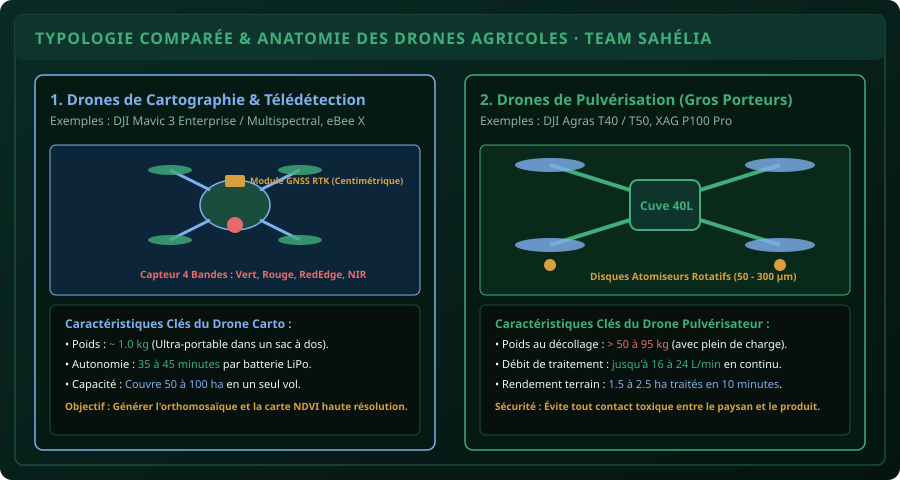

# CHAPITRE 1 : TYPOLOGIE & ANATOMIE DES DRONES AGRICOLES
## Comprendre l'architecture mécanique, les capteurs et différencier cartographie et pulvérisation

> **Manuel :** 11 — Pilotage de Drones & Drones Agricoles : Cartographie, Télédétection & Pulvérisation de Précision  
> **Auteur :** Sègla Bio KPEROU, Olivier AREMOU & TEAM Sahélia  
> **Temps d’apprentissage :** 45 minutes de lecture + 30 minutes de manipulation machine  
> **Illustration associée :** `schemas/schema_01_anatomie_et_types_drones.svg`

---

## 1. Objectifs d'Impact Réel
À la fin de ce chapitre, vous saurez :
1. **Distinguer sans hésitation les deux grandes familles de drones** : Voilures tournantes (multi-rotors) et Voilures fixes (ailes volantes).
2. **Identifier les différences techniques majeures** entre un drone de cartographie/télédétection (léger, capteurs multispectraux) et un drone gros porteur de pulvérisation agricole (lourd, cuve liquide, atomiseurs rotatifs).
3. **Nommer et comprendre le rôle de chaque composant vital** : Moteurs Brushless, ESC, Contrôleur de vol, IMU, Boussole magnétique, module GNSS RTK et batteries LiPo/LFP.
4. **Comprendre la chaîne d'alimentation électrique** et les règles de stockage des batteries LiPo sous climat tropical chaud (> 35°C).
5. **Choisir le drone adapté** à votre cahier des charges agronomique (audit de verger, délimitation cadastrale, ou traitement de ravageurs en urgence).

---

## 2. Les Deux Grandes Familles Aérodynamiques

Dans le domaine civil et agricole, les aéronefs télépilotés (drones) se divisent en deux architectures principales :

1. **Les Voilures Tournantes (Multi-rotors : Quadricoptères, Hexacoptères, Octocoptères) :**
   - **Avantages :** Décollage et atterrissage verticaux stricts (VTOL), capacité de vol stationnaire millimétrique au-dessus d'une zone suspecte, maniabilité extrême entre les arbres.
   - **Inconvénients :** Consommation énergétique élevée, vitesse de croisière modérée (10 à 15 m/s), autonomie limitée à 30-45 minutes.
   - **Usage :** Idéal pour la pulvérisation agricole et la cartographie de parcelles paysannes de 1 à 100 hectares.

2. **Les Voilures Fixes (Ailes volantes & Avions) :**
   - **Avantages :** Portance générée par les ailes (faible consommation de batterie), grande vitesse de croisière (20 à 25 m/s), couverture gigantesque (jusqu'à 500 à 1 000 ha en une seule mission).
   - **Inconvénients :** Nécessite une piste dégagée ou un filet/parachute pour l'atterrissage, impossibilité de faire du vol stationnaire, sensibilité aux rafales de vent au ras du sol.
   - **Usage :** Cartographie de grands domaines forestiers, périmètres irrigués de canne à sucre ou grands bassins cotonniers.



---

## 3. Comparatif : Drone Cartographique vs Drone de Pulvérisation

| Paramètre Technique | Drone de Cartographie (ex: DJI Mavic 3M) | Drone de Pulvérisation (ex: DJI Agras T40) |
| :--- | :--- | :--- |
| **Poids à vide** | $\approx 0.95\text{ kg}$ | $\approx 38\text{ kg}$ |
| **Masse Max au Décollage (MTOW)** | $1.05\text{ kg}$ | **$90\text{ à }100\text{ kg}$ (avec 40 L de produit)** |
| **Charge utile principale** | Caméra RGB 20 MP + 4 capteurs multispectraux | Cuve liquide étanche 40 litres + pompes haute pression |
| **Système de dispersion** | Aucun (capteur optique passif) | 2 atomiseurs rotatifs centrifuges à taille de gouttelette réglable |
| **Autonomie par batterie** | 35 à 43 minutes | 8 à 12 minutes (travail intensif sous pleine charge) |
| **Objectif agronomique** | **Diagnostiquer** : NDVI, comptage de plants, élévation | **Agir** : Traiter, fertiliser, désherber au centimètre près |

---

## 4. Anatomie Mécanique & Électronique d'un Drone Moderne

Un drone professionnel n'est pas un simple jouet téléguidé ; c'est un concentré d'avionique embarquée :

1. **Le Châssis (*Frame*) :** Fabriqué en fibre de carbone tressée et polymères renforcés, alliant légèreté extrême et résistance aux vibrations mécaniques.
2. **La Motorisation :**
   - **Moteurs Brushless (Sans balais) :** Fonctionnent par champ magnétique rotatif triphasé, offrant un rendement énergétique supérieur à 90 % et une longévité sans friction.
   - **ESC (*Electronic Speed Controllers*) :** Régulateurs électroniques qui convertissent le courant continu de la batterie en impulsions triphasées pour faire varier la vitesse des moteurs des milliers de fois par seconde.
   - **Hélices :** En fibre de carbone ou plastique composite renforcé, équilibrées dynamiquement pour éliminer l'effet "Jello" sur les caméras.
3. **Le Cerveau de Vol (*Flight Controller*) :**
   - **L'IMU (*Inertial Measurement Unit*) :** Combine 3 accéléromètres et 3 gyroscopes pour mesurer l'inclinaison et la vitesse angulaire du drone.
   - **Le Baromètre :** Mesure la pression atmosphérique pour stabiliser l'altitude barométrique.
   - **La Boussole Magnétique (*Compas*) :** Détermine le cap géographique. *Attention : sensible aux perturbations ferromagnétiques au sol (carrosseries de véhicules, béton armé)*.
   - **Le Récepteur GNSS RTK :** Reçoit simultanément les constellations GPS (USA), GLONASS (Russie), Galileo (Europe) et BeiDou (Chine). Relié à une base RTK locale, il atteint une précision de **1 à 2 centimètres** !
4. **La Batterie de Puissance (LiPo / LFP) :**
   - Lithium-Polymère (LiPo) haute décharge (taux de décharge de 25C à 60C).
   - Tension nominale : $3.7\text{ V}$ par cellule (LiPo 4S = $14.8\text{ V}$, LiPo 6S = $22.2\text{ V}$, Agras 14S = $52.2\text{ V}$).

---

## 5. La Gestion des Batteries sous Climat Tropical (Bénin & Sahel)

En Afrique de l'Ouest, les températures ambiantes dépassent fréquemment 38°C en saison sèche. Une batterie LiPo mal gérée gonfle, perd sa capacité en 20 cycles, ou peut s'enflammer violemment (*emballement thermique*).

### Les 4 Règles d'Or TEAM Sahélia pour les Batteries :
1. **Ne jamais charger une batterie brûlante :** Dès l'atterrissage, attendez 15 à 20 minutes que la batterie redescende à la température ambiante avant de la brancher sur le générateur ou le chargeur rapide.
2. **Ne jamais décharger sous les 15 % :** Une cellule LiPo qui descend en dessous de $3.0\text{ V}$ subit une dégradation chimique irréversible. Déclenchez l'atterrissage automatique dès 20-25 %.
3. **Tension de Stockage (*Storage*) :** Si vous ne volez pas pendant plus de 48 heures, mettez les batteries en mode stockage à **$3.85\text{ V}$ par cellule** (environ 50-60 % de charge). Les chargeurs intelligents DJI le font automatiquement.
4. **Protection thermique sur le terrain :** Conservez les packs de batteries à l'ombre dans une glacière ventilée ou une mallette ignifugée (*LiPo Safe Bag*).

---

## 6. Le Défi Hebdo TEAM Sahélia

> ### 🏆 Défi Hebdo n°11-A : L'Audit d'Équipement Drone
> 
> 1. Établissez une fiche technique comparative entre un drone de cartographie (ex: Mavic 3 Multispectral) et un drone pulvérisateur (ex: Agras T40).
> 2. Définissez pour une exploitation maraîchère de 15 ha à Parakou :
>    - Le nombre de batteries nécessaires pour cartographier la parcelle en une matinée.
>    - Le volume de bouillie total nécessaire pour traiter la même parcelle avec une dose de 20 L/ha.
> 3. Postez votre synthèse sur le canal TEAM Sahélia avec la mention :  
>    *« Défi Manuel 11 - Chapitre 1 Drone Validé ! »*.

---

## 7. Fiche Mémo Récapitulative Détachable

```text
================================================================================
             FICHE MÉMO · TYPOLOGIE & ANATOMIE DES DRONES AGRICOLES
================================================================================
1. LES 2 USAGES MAJEURS EN AGRONOMIE :
   - Cartographie / Télédétection : Appareil léger (1 kg), capteur multispectral,
     génération d'orthomosaïques et cartes NDVI de vigueur foliaire.
   - Pulvérisation de précision   : Gros porteur (50-100 kg), cuve liquide 20-40 L,
     atomiseurs rotatifs centrifuges, pulvérisation ciblée sans piétinement.

2. COMPOSANTS CLÉS DU CONTRÔLE DE VOL :
   - IMU (Gyroscopes + Accéléromètres) : Maintien de l'équilibre horizontal.
   - Compas magnétique                 : Orientation géographique (Cap Nord).
   - Module RTK double antenne         : Précision de positionnement centimétrique.
   - Baromètre                         : Gestion de la hauteur de vol relative.

3. RÈGLE DES BATTERIES LIPO EN MILIEU TROPICAL :
   - Plage d'utilisation idéale : 20 % à 90 % de charge.
   - Température maximale tolérée : 45°C (Refroidir avant recharge).
   - Stockage prolongé (> 3 jours) : 3.85 V par cellule (50 % de charge).
================================================================================
TEAM Sahélia · Apprendre. Créer. Innover.
================================================================================
```
