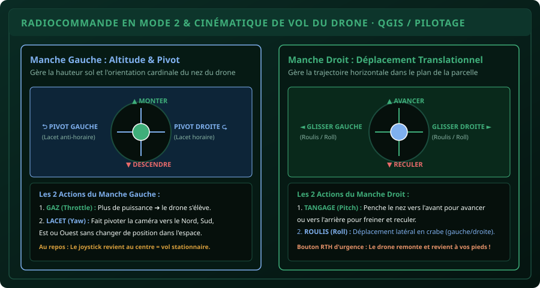

# CHAPITRE 2 : FONDEMENTS DU PILOTAGE & COMMANDES EN MODE 2
## Maîtriser la radiocommande, la cinématique 3D et les procédures de sécurité d'urgence

> **Manuel :** 11 — Pilotage de Drones & Drones Agricoles : Cartographie, Télédétection & Pulvérisation de Précision  
> **Auteur :** Sègla Bio KPEROU, Olivier AREMOU & TEAM Sahélia  
> **Temps d’apprentissage :** 40 minutes de cours théorique + 45 minutes de pratique sur simulateur / terrain  
> **Illustration associée :** `schemas/schema_02_joysticks_mode2_et_mouvements.svg`

---

## 1. Objectifs d'Impact Réel
À la fin de ce chapitre, vous saurez :
1. **Comprendre et mémoriser instinctivement le standard mondial Mode 2** de pilotage radiocommandé.
2. **Dissocier les 4 mouvements physiques fondamentaux** : Gaz (*Throttle*), Lacet (*Yaw*), Tangage (*Pitch*) et Roulis (*Roll*).
3. **Réagir au piège de l'inversion des commandes** lorsque le nez du drone fait face au télépilote.
4. **Passer du mode de vol assisté GPS (P-Mode) au mode manuel (Atti-Mode)** en cas de perte de signal satellite.
5. **Configurer et déclencher la procédure de retour automatique au point de départ (*Return-to-Home - RTH*)** pour sauver l'appareil lors d'une perte de liaison radio.

---

## 2. Le Standard Mondial : La Radiocommande en Mode 2

Sur le marché des drones civils et agricoles (DJI, Autel, Parrot, XAG), il existe plusieurs configurations de radiocommande (Mode 1, Mode 2, Mode 3, Mode 4). **Le Mode 2 est le standard international universel adopté par 95 % des pilotes dans le monde**, car il reproduit fidèlement les commandes réelles d'un manche à balai d'hélicoptère.



### Répartition des Axes entre vos Deux Mains :

#### 1. Le Manche Gauche (Altitude & Pivotement Azimutal) :
- **Axe Vertical (Haut / Bas) = GAZ (*Throttle*) :**
  - Pousser vers le **Haut** : Augmente le régime des moteurs $\rightarrow$ Le drone monte verticalement.
  - Tirer vers le **Bas** : Réduit la poussée $\rightarrow$ Le drone descend verticalement.
  - Au centre : Le drone maintient son altitude exacte grâce à son baromètre et son capteur optique.
- **Axe Horizontal (Gauche / Droite) = LACET (*Yaw*) :**
  - Pousser vers la **Gauche** : Le drone pivote sur lui-même vers la gauche (sens anti-horaire).
  - Pousser vers la **Droite** : Le drone pivote sur lui-même vers la droite (sens horaire).
  - *La position géographique X, Y et l'altitude Z ne changent pas : seul le nez de l'appareil tourne.*

#### 2. Le Manche Droit (Déplacement Translationnel Horizontal) :
- **Axe Vertical (Haut / Bas) = TANGAGE (*Pitch*) :**
  - Pousser vers le **Haut** : Les moteurs arrière accélèrent $\rightarrow$ Le drone s'incline vers l'avant et avance dans la direction de son nez.
  - Tirer vers le **Bas** : Les moteurs avant accélèrent $\rightarrow$ Le drone s'incline vers l'arrière, freine ou recule.
- **Axe Horizontal (Gauche / Droite) = ROULIS (*Roll*) :**
  - Pousser vers la **Gauche** : Le drone s'incline à gauche et glisse latéralement en crabe.
  - Pousser vers la **Droite** : Le drone s'incline à droite et glisse latéralement en crabe.

---

## 3. Le Piège de l'Inversion des Commandes (« Face au Pilote »)

C'est l'erreur numéro un qui cause 80 % des crashs chez les débutants :
- **Tant que le drone a le dos tourné vers vous (le nez pointe vers le champ) :**  
  Pousser le manche droit vers la droite fait aller le drone vers **votre** droite.
- **Dès que le drone fait demi-tour et vous fait face (le nez pointe vers vous) :**  
  Les commandes de translation sont **inversées par rapport à votre regard** ! Si vous poussez le manche vers la droite, le drone va vers sa propre droite, qui correspond à **votre gauche** ! Dans la panique, l'élève novice pousse le manche à l'opposé et percute un arbre.

> [!TIP]
> ### L'Astuce Pédagogique TEAM Sahélia :
> Pendant vos 10 premières heures de vol, visualisez toujours la scène **depuis le cockpit virtuel du drone**, ou déplacez légèrement votre corps pour vous aligner dans le sens de la trajectoire du drone. Si vous perdez l'orientation spatiale, **lâchez immédiatement les deux joysticks** : en mode P-GPS, le drone freine instantanément et reste figé dans les airs !

---

## 4. Les 3 Modes de Vol Essentiels

1. **Le Mode P (Positioning / GPS Mode) :**  
   C'est le mode par défaut. Le drone utilise la constellation de satellites GNSS et ses capteurs optiques inférieurs pour verrouiller sa position. Même sous une brise de vent de $25\text{ km/h}$, le drone ne bouge pas d'un centimètre si vous ne touchez pas à la radiocommande.
2. **Le Mode Atti (Attitude Mode) :**  
   Le module GPS est désactivé (soit volontairement, soit à cause d'une perte de signal sous un couvert forestier dense). Le drone stabilise uniquement son assiette horizontale et son altitude barométrique, mais **il dérive librement avec la force du vent**.  
   *Le pilote doit compenser manuellement chaque seconde au manche droit pour maintenir l'appareil en place.* La maîtrise de ce mode est obligatoire pour obtenir une licence de télépilote professionnel.
3. **Le Mode S (Sport Mode) :**  
   Vitesse maximale débridée (jusqu'à $75\text{ km/h}$), inclinaison maximale accrue, mais les capteurs anticollision sont automatiquement désactivés ! Réservé aux vols de transit rapides en espace totalement dégagé.

---

## 5. La Procédure Vitale de RTH (*Return-to-Home*)

Le *Return-to-Home* est l'algorithme de survie du drone. Il ramène l'appareil de manière autonome à son point de décollage (*Home Point*) enregistré au GPS lors de l'armement des moteurs.

### Les 3 Déclencheurs du RTH :
1. **RTH Manuel (Smart RTH) :** Vous appuyez 2 secondes sur le bouton `H` de la radiocommande.
2. **RTH Failsafe (Perte de Signal Radio) :** Si la liaison entre la radiocommande et le drone est interrompue pendant plus de 3 secondes (obstacle physique, brouillage, batterie de la radio vide), le drone déclenche le RTH de sécurité.
3. **RTH Batterie Critique (Low Battery RTH) :** Le drone calcule en temps réel la distance qui le sépare du point de décollage et la puissance nécessaire pour revenir face au vent. Quand la batterie atteint le seuil critique calculé, le retour forcé démarre automatiquement.

> [!CAUTION]
> ### La Règle d'Or de l'Altitude RTH :
> Avant chaque décollage, vous **DEVEZ** vérifier et paramétrer l'**Altitude RTH** dans l'application de vol :
> - Mesurez mentalement l'obstacle le plus haut du secteur (ex: un grand fromager ou mât d'antenne de 35 mètres).
> - Réglez l'altitude RTH à **au moins 15 mètres au-dessus de l'obstacle le plus haut** (ex: $50\text{ mètres}$).
> - *Si votre altitude RTH est fixée à 20 mètres et que le drone rencontre un arbre de 30 mètres sur sa trajectoire de retour en ligne droite, il s'écrasera directement dedans !*

---

## 6. Le Défi Hebdo TEAM Sahélia

> ### 🏆 Défi Hebdo n°11-B : Les 4 Figures de Base du Télépilote
> 
> Sur simulateur (DJI Flight Simulator) ou sur terrain dégagé avec un drone école :
> 1. **Décollage vertical** et montée à 1.5 mètre sol.
> 2. **Le Vol Stationnaire Parfait (*Hovering*) :** Maintenir le drone immobile pendant 2 minutes consécutives face à vous, puis dos à vous.
> 3. **Le Carré Horizontal :** Réaliser un carré de 10 m de côté à altitude constante de 2 mètres sans pivoter le nez du drone (uniquement au manche droit : avant, droite, arrière, gauche).
> 4. **Le Cercle en Lacet Combiné :** Réaliser un cercle complet autour d'un point central tout en gardant le nez de la caméra constamment pointé vers ce repère (combinaison simultanée du lacet gauche et du roulis droit).
> 5. Postez votre confirmation d'exercice avec la mention :  
>    *« Défi Pilotage de Base Mode 2 Validé ! »*.

---

## 7. Fiche Mémo Récapitulative Détachable

```text
================================================================================
             FICHE MÉMO · COMMANDES RADIO ET SÉCURITÉ DE VOL
================================================================================
1. TABLEAU DE BORD MODE 2 (MÉMORISER À VIE) :
   - Main GAUCHE :
     * Haut/Bas       : Montée / Descente (Gaz - Throttle)
     * Gauche/Droite  : Rotation horaire / anti-horaire (Lacet - Yaw)
   - Main DROITE :
     * Haut/Bas       : Avancer / Reculer (Tangage - Pitch)
     * Gauche/Droite  : Glisser à gauche / Glisser à droite (Roulis - Roll)

2. COMPORTEMENT DE L'ALGORITHME RTH :
   - Étape 1 : Le drone pivote vers le point de départ (Home Point).
   - Étape 2 : Si altitude courante < Altitude RTH réglée ➔ Il monte à l'altitude RTH.
   - Étape 3 : Il effectue le vol en ligne droite vers le point de décollage.
   - Étape 4 : Arrivé au-dessus du point, il entame la descente verticale et se pose.

3. RÈGLE D'OR EN CAS DE PANIQUE :
   - Lâcher complètement les joysticks !
   - Le système GPS P-Mode immobilise instantanément le drone dans les airs.
================================================================================
TEAM Sahélia · Apprendre. Créer. Innover.
================================================================================
```
