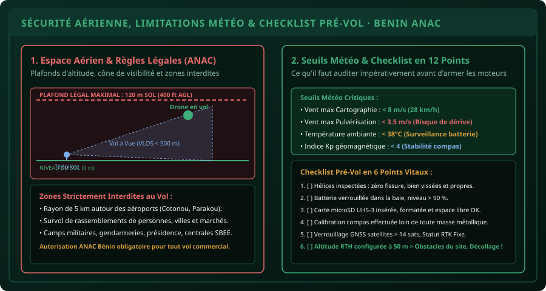

# CHAPITRE 3 : SÉCURITÉ AÉRIENNE, MÉTÉO & RÉGLEMENTATION
## Respecter la législation béninoise, maîtriser les facteurs météorologiques et appliquer la checklist pré-vol

> **Manuel :** 11 — Pilotage de Drones & Drones Agricoles : Cartographie, Télédétection & Pulvérisation de Précision  
> **Auteur :** Sègla Bio KPEROU, Olivier AREMOU & TEAM Sahélia  
> **Temps d’apprentissage :** 45 minutes de lecture + 20 minutes d'audit de sécurité sur le terrain  
> **Illustration associée :** `schemas/schema_03_securite_meteo_et_checklist.svg`

---

## 1. Objectifs d'Impact Réel
À la fin de ce chapitre, vous saurez :
1. **Connaître les exigences réglementaires de l'Agence Nationale de l'Aviation Civile (ANAC Bénin)** et de l'OACI pour le télépilotage d'aéronefs civils.
2. **Respecter scrupuleusement les limitations d'espace aérien** : Plafond légal des $120\text{ mètres}$ sol, vol à vue directe (*VLOS*), et respect des zones d'exclusion (*No-Fly Zones*).
3. **Évaluer les conditions météorologiques critiques** : Vitesse du vent en rafales, turbulence thermique, indice d'activité géomagnétique solaire (Kp Index).
4. **Comprendre les spécificités de la pulvérisation par rapport à la météo** : pourquoi une brise de $4\text{ m/s}$ suffit à annuler un vol de traitement phytosanitaire.
5. **Exécuter la Checklist Pré-vol rigoureuse en 12 points** pour éliminer 99 % des risques d'incidents matériels et humains.

---

## 2. Le Cadre Réglementaire au Bénin & en Afrique de l'Ouest

Faire voler un drone n'est pas un acte anodin. Dès que vos patins quittent la terre ferme, vous partagez l'espace aérien national avec l'aviation civile et militaire.



### Les 4 Piliers Légaux Fondamentaux :
1. **Le Plafond Légal d'Altitude ($120\text{ m}$ / $400\text{ ft}$ AGL) :**  
   Il est formellement interdit de dépasser **$120\text{ mètres}$ de hauteur par rapport au sol** sans autorisation spéciale de l'aviation civile. En dessous de 120 m, vous évoluez dans la tranche réservée aux drones ; au-dessus de 150 m commence le domaine des hélicoptères de secours, des évacuations sanitaires et des avions légers en approche.
2. **Le Vol à Vue Directe (*VLOS - Visual Line of Sight*) :**  
   Le télépilote doit garder son appareil **en contact visuel direct, permanent et sans aide optique** (jumelles interdites comme substitut de vue). La distance maximale opérationnelle en VLOS est généralement de **$500\text{ mètres}$** autour de vous. Au-delà, l'orientation du drone n'est plus perceptible à l'œil nu.
3. **L'Interdiction de Survol des Personnes :**  
   Ne jamais survoler de rassemblements de population, de villages denses, de cours d'écoles ou de marchés périodiques. En cas de panne moteur soudaine, un drone de $1\text{ kg}$ tombant de $80\text{ mètres}$ a une énergie cinétique létale ; un drone de traitement de $70\text{ kg}$ se transforme en véritable projectile destructeur.
4. **Les Zones d'Exclusion Aérienne (*No-Fly Zones* - NFZ) :**  
   - Rayon d'exclusion absolue de **$5\text{ km}$** autour de l'Aéroport International de Cotonou (Cadjehoun) et de l'Aérodrome de Tourou à Parakou.
   - Les camps militaires, commissariats de police, ministères, ambassades et centrales électriques de la SBEE.
   - Les parcs nationaux protégés (Parc de la Pendjari et Parc du W) sans autorisation spéciale de l'Agence Nationale de promotion des Patrimoines et de développement du Tourisme (ANPT).

---

## 3. Les Facteurs Météorologiques Déterminants

Les capteurs électroniques d'un drone sont extrêmement sensibles à l'environnement atmosphérique :

### 1. Le Vent au Sol et en Altitude :
- **Pour la Cartographie Photogrammétrique :** Seuil maximal toléré = **$8\text{ m/s}$ (environ $28\text{ km/h}$)**. Au-delà, le drone consomme le double d'énergie pour lutter contre le vent, la nacelle de la caméra vibre et les photos souffrent de flou de bougé.
- **Pour la Pulvérisation Agricole :** Seuil maximal toléré = **$3.5\text{ m/s}$ (environ $12\text{ km/h}$)**. Au-delà, le vent latéral déporte le nuage de gouttelettes (*Spray Drift*) sur la parcelle du voisin ou dans un cours d'eau, annulant l'efficacité du traitement !

### 2. La Chaleur Tropicale et les Turbulences Thermiques :
À midi au Nord-Bénin, le soleil chauffe brutalement le sol nu, créant des colonnes d'air chaud ascendantes puissantes (*thermiques*) qui déstabilisent l'assiette du drone.  
*La fenêtre idéale de vol en agronomie se situe entre **6h30 et 10h00 le matin**, et entre **16h00 et 18h30 en fin d'après-midi**.*

### 3. L'Indice d'Activité Géomagnétique Solaire (Indice Kp) :
Les éruptions solaires perturbent le champ magnétique terrestre et la précision des signaux satellites :
- **$\text{Kp} \le 3$ :** Conditions excellentes.
- **$\text{Kp} \ge 5$ (Tempête géomagnétique) :** Risque sévère de perte subite du signal GPS ou de désorientation du compas magnétique, provoquant le basculement forcé en mode Atti incontrôlé. Consultez toujours l'application mobile *UAV Forecast* avant de voler.

---

## 4. La Checklist Pré-Vol en 12 Points TEAM Sahélia

Avant d'armer les moteurs, le télépilote passe en revue la checklist méthodique :

```text
[ ] 01. ENVIRONNEMENT : Espace dégagé, aucun curieux ou enfant à moins de 10 m.
[ ] 02. HÉLICES : Inspection visuelle des pales (zéro fissure, poussière essuyée).
[ ] 03. CHÂSSIS : Bras dépliés et fermement verrouillés par les bagues de serrage.
[ ] 04. NACELLE : Retrait du cache de protection plastique de la caméra.
[ ] 05. OPTIQUE : Nettoyage de la lentille du capteur avec chiffon microfibre.
[ ] 06. STOCKAGE : Carte microSD rapide (U3 / V30) insérée et formatée.
[ ] 07. BATTERIE MACHINE : Enclenchement avec double clic audible, charge > 90 %.
[ ] 08. RADIOCOMMANDE : Antennes orientées à 90° vers le ciel, batterie > 80 %.
[ ] 09. ALLUMAGE : Allumer la radio D'ABORD, puis allumer le drone EN SECOND.
[ ] 10. COMPAS : Vérifier l'absence d'interférence magnétique locale.
[ ] 11. SATELLITES : Attendre l'acquisition de plus de 14 satellites GNSS (Statut Vert).
[ ] 12. SÉCURITÉ RTH : Vérifier que l'altitude RTH est réglée à 50 m. "HOME POINT ENREGISTRÉ".
```

---

## 5. Le Défi Hebdo TEAM Sahélia

> ### 🏆 Défi Hebdo n°11-C : L'Évaluation Météo & Risques
> 
> 1. Téléchargez une application météo pour drones (ex: *UAV Forecast* sur smartphone).
> 2. Analysez les conditions météo actuelles de votre localité :
>    - Vitesse du vent au sol et à $100\text{ m}$ d'altitude.
>    - Indice Kp solaire du jour.
>    - Visibilité et couverture nuageuse.
> 3. Déterminez si l'heure actuelle est propice pour un vol de pulvérisation, pour un vol de cartographie, ou si le vol doit être reporté.
> 4. Rédigez votre fiche d'analyse météo et publiez-la sur le forum avec la mention :  
>    *« Défi Sécurité & Météo Télépilote Validé ! »*.

---

## 6. Fiche Mémo Récapitulative Détachable

```text
================================================================================
             FICHE MÉMO · SÉCURITÉ AÉRIENNE & CHECKLIST DU PILOTE
================================================================================
1. LIMITES LÉGALES NON NÉGOCIABLES :
   - Hauteur de vol maximale : 120 mètres au-dessus du sol.
   - Distance maximale à vue (VLOS) : 500 mètres du télépilote.
   - Survol interdit : Aéroports (5 km), foule, militaires, institutions publiques.

2. SEUILS MÉTÉO OPÉRATIONNELS :
   - Cartographie multispectrale : Vent < 8 m/s (28 km/h).
   - Traitement par pulvérisation : Vent < 3.5 m/s (12 km/h) - risque de dérive chimique.
   - Tempête solaire (Indice Kp)  : Ne jamais voler si Kp > 4.

3. ORDRE SACRÉ DE MISE SOUS TENSION :
   - À L'ALLUMAGE    : Allumer la radiocommande PUIS allumer le drone.
   - À L'EXTINCTION  : Éteindre le drone PUIS éteindre la radiocommande.
   (Évite que le drone ne reçoive un signal parasite en l'absence de radio active !)
================================================================================
TEAM Sahélia · Apprendre. Créer. Innover.
================================================================================
```
