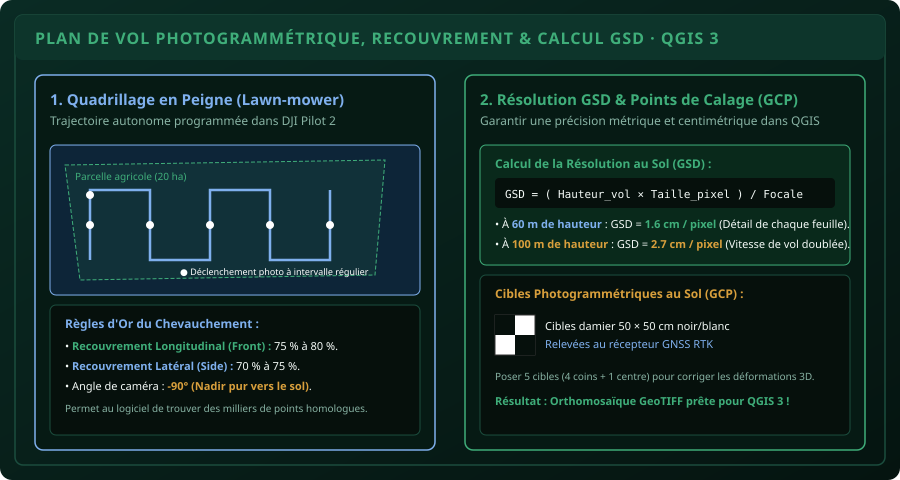

# CHAPITRE 4 : MISSIONS AUTOMATISÉES & PHOTOGRAMMÉTRIE
## Programmer des plans de vol en peigne, calculer le GSD et générer des orthomosaïques géoréférencées

> **Manuel :** 11 — Pilotage de Drones & Drones Agricoles : Cartographie, Télédétection & Pulvérisation de Précision  
> **Auteur :** Sègla Bio KPEROU, Olivier AREMOU & TEAM Sahélia  
> **Temps d’apprentissage :** 50 minutes de lecture + 40 minutes de planification sur application de vol  
> **Illustration associée :** `schemas/schema_04_plan_de_vol_photogrammetrie_gsd.svg`

---

## 1. Objectifs d'Impact Réel
À la fin de ce chapitre, vous saurez :
1. **Comprendre pourquoi le pilotage manuel est proscrit** lors des missions de cartographie aérienne.
2. **Programmer un plan de vol photogrammétrique autonome en peigne** (*Lawn-mower grid*) dans des applications comme DJI Pilot 2, Pix4Dcapture ou UgCS.
3. **Paramétrer rigoureusement les taux de recouvrement longitudinal (75-80 %) et latéral (70-75 %)** indispensables à l'assemblage 3D.
4. **Calculer la résolution spatiale au sol (*Ground Sampling Distance - GSD*)** en centimètres par pixel en fonction de la hauteur de vol et de la focale.
5. **Positionner des cibles photogrammétriques au sol (*GCP*)** pour obtenir une précision géométrique submétrique voire centimétrique.
6. **Passer du vol drone au SIG** : exporter une orthomosaïque GeoTIFF prête pour QGIS 3 (faisant le pont direct avec le Manuel 06).

---

## 2. Le Principe de la Photogrammétrie par Drone

La photogrammétrie est la technique qui permet de reconstituer une surface en 3 dimensions et une vue d'ensemble métrique parfaitement plane (*orthomosaïque*) à partir d'une série de photos 2D prises sous des angles légèrement décalés mais qui se chevauchent.



### Pourquoi le Pilote Humain ne Touche pas aux Joysticks :
Pour que l'algorithme informatique (SfM - *Structure from Motion*) retrouve les mêmes brins d'herbe ou les mêmes sillons sur plusieurs clichés consécutifs, il faut :
- Une vitesse de translation strictement constante.
- Une altitude de vol constante par rapport au relief du sol (*Terrain Following*).
- Un déclenchement photographique automatique calculé à la fraction de seconde près.
- Un angle de caméra rigoureusement orienté à **$-90^\circ$ (Nadir pur vers le sol)**.

---

## 3. Les Paramètres Clés d'un Plan de Vol Efficace

Dans votre logiciel de planification de mission (ex: DJI Pilot 2 sur la radiocommande) :

1. **La Délimitation de la Zone (Polygone KML) :**  
   Vous pouvez importer directement le fichier `.kml` de la parcelle créé dans QGIS ou tracer les sommets à l'écran sur fond Google Satellite.
2. **Le Recouvrement (*Overlap*) :**
   - **Recouvrement Longitudinal (*Front Overlap*) :** **$75\text{ à }80\,\%$**. C'est le pourcentage de surface partagée entre deux photos successives sur la même ligne de vol.
   - **Recouvrement Latéral (*Side Overlap*) :** **$70\text{ à }75\,\%$**. C'est le pourcentage de surface partagée entre deux lignes de vol parallèles adjacentes.
   - *Si le recouvrement est insuffisant (< 60 %), l'assemblage échoue et produit des "trous" noirs sur l'orthomosaïque finale.*
3. **La Vitesse d'Obturation (*Shutter Speed*) :**  
   Réglez la vitesse d'obturation de l'appareil à **$1/1000\text{ s}$ minimum** (en augmentant légèrement les ISO si le ciel est voilé). Cela supprime tout risque de flou cinétique induit par l'avancement du drone.

---

## 4. Calcul Mathématique de la Résolution au Sol (GSD)

Le **GSD (*Ground Sampling Distance*)** représente la taille réelle au sol couverte par un seul pixel de l'image.

$$\text{GSD} = \frac{H \times S_w}{F \times I_w}$$

- $H$ = Hauteur de vol au-dessus du sol (en millimètres).
- $S_w$ = Largeur physique du capteur photographique (en millimètres, ex: $17.3\text{ mm}$ pour un capteur 4/3").
- $F$ = Longueur focale réelle de l'objectif (en millimètres, ex: $12.2\text{ mm}$).
- $I_w$ = Largeur de l'image en pixels (ex: $5280\text{ pixels}$).

### Exemple d'Application Réelle :
- Un vol réalisé à **$60\text{ mètres}$ de hauteur** produit un GSD d'environ **$1.6\text{ cm par pixel}$**. Vous pouvez littéralement compter le nombre d'épis de maïs ou identifier les adventices au sol !
- Un vol réalisé à **$100\text{ mètres}$ de hauteur** produit un GSD d'environ **$2.7\text{ cm par pixel}$**. La surface couverte par batterie est doublée, ce qui est parfait pour une vue d'ensemble cadastrale ou un indice NDVI global.

---

## 5. L'Implantation des Cibles au Sol (Ground Control Points - GCP)

Si votre drone n'est pas équipé d'un module RTK connecté à une base fixe, le GPS interne du drone présente une marge d'erreur naturelle de $1.5\text{ à }3\text{ mètres}$. Pour ancrer l'orthomosaïque à sa position absolue exacte :

1. Déposez au sol **5 cibles carrées en damier noir et blanc ($50\times 50\text{ cm}$)** avant le décollage : 1 cible à chaque coin de la parcelle et 1 cible au centre.
2. Relevez les coordonnées exactes du centre de chaque cible à l'aide d'un récepteur GNSS différentiel ou de la méthode de géoréférencement vue au Chapitre 2 du Manuel 06.
3. Lors du traitement dans le logiciel photogrammétrique (WebODM, Pix4D, Agisoft Metashape), pointez ces cibles : votre modèle 3D s'ajuste au centimètre près !

---

## 6. Du Vol Drone à l'Intégration dans QGIS 3

Une fois le traitement photogrammétrique terminé, vous obtenez :
1. Une **Orthomosaïque RVB haute définition** (fichier `.tif` GeoTIFF géoréférencé).
2. Un **Modèle Numérique de Surface (MNS / DSM)** qui traduit l'élévation et la hauteur de chaque arbre ou billon.

Dans QGIS 3 (Manuel 06) :
- Glissez simplement le GeoTIFF dans le canevas.
- L'orthomosaïque se cale automatiquement à son emplacement géographique exact en projection UTM 31N (`EPSG:32631`).
- Vous pouvez désormais digitaliser les limites parcellaires avec une précision mille fois supérieure aux photos satellites gratuites !

---

## 7. Le Défi Hebdo TEAM Sahélia

> ### 🏆 Défi Hebdo n°11-D : La Programmation de Mission
> 
> 1. Installez un planificateur de vol (ex: application simulateur DJI Pilot 2 ou Mission Planner sur PC).
> 2. Définissez une zone agricole de 10 hectares.
> 3. Configurez :
>    - Altitude de vol : $75\text{ mètres}$.
>    - Chevauchement : 80 % frontal, 70 % latéral.
>    - Vitesse de vol : adaptée pour ne pas dépasser la cadence de prise de vue du capteur.
> 4. Relevez le temps de vol estimé, le nombre total de photos qui seront prises, et le GSD théorique calculé.
> 5. Partagez votre plan de vol sur le forum avec la mention :  
>    *« Défi Plan de Vol Photogrammétrique Validé ! »*.

---

## 8. Fiche Mémo Récapitulative Détachable

```text
================================================================================
             FICHE MÉMO · PHOTOGRAMMÉTRIE & PLANS DE VOL AUTONOMES
================================================================================
1. CONSTANTES D'UN PLAN DE VOL CARTOGRAPHIQUE :
   - Trajectoire : Grille régulière en peigne (Lawn-mower).
   - Angle de caméra (Gimbal Pitch) : -90° (Nadir strict vers le sol).
   - Recouvrement longitudinal (Front Overlap) : 75 % à 80 %.
   - Recouvrement latéral (Side Overlap)       : 70 % à 75 %.

2. COMPROMIS HAUTEUR / GSD :
   - Vol basse altitude (40-60 m)  : Très haute résolution (1.2 - 1.6 cm/px),
     mais surface couverte réduite et grand nombre de photos.
   - Vol haute altitude (90-120 m) : Couverture rapide de grandes parcelles (2.5 - 3.2 cm/px),
     idéal pour la cartographie régionale et le suivi NDVI.

3. RÈGLE D'OR DE L'OBTURATEUR :
   - Vitesse d'obturation >= 1/1000s pour figer le mouvement et éliminer le flou cinétique.
================================================================================
TEAM Sahélia · Apprendre. Créer. Innover.
================================================================================
```
