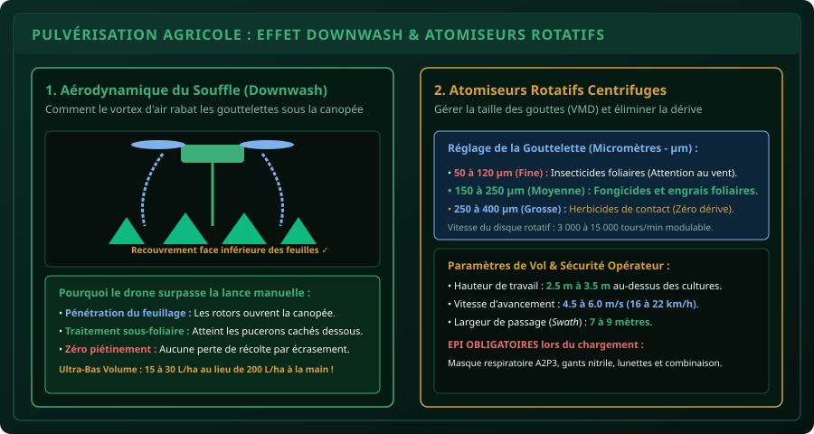

# CHAPITRE 5 : DRONES DE PULVÉRISATION AGRICOLE & CALIBRATION
## Maîtriser l'effet Downwash, régler les atomiseurs rotatifs et calibrer les débits par hectare

> **Manuel :** 11 — Pilotage de Drones & Drones Agricoles : Cartographie, Télédétection & Pulvérisation de Précision  
> **Auteur :** Sègla Bio KPEROU, Olivier AREMOU & TEAM Sahélia  
> **Temps d’apprentissage :** 50 minutes de lecture + 45 minutes d'atelier de calibration liquide  
> **Illustration associée :** `schemas/schema_05_drone_pulverisation_downwash.svg`

---

## 1. Objectifs d'Impact Réel
À la fin de ce chapitre, vous saurez :
1. **Comprendre l'aérodynamique du souffle des rotors (*Downwash*)** et son rôle crucial dans l'ouverture de la canopée végétale.
2. **Maîtriser la technologie des atomiseurs rotatifs centrifuges** par rapport aux buses traditionnelles à pression.
3. **Calibrer avec précision le diamètre médian volumique (VMD)** des gouttelettes (de 50 à 400 microns) selon le type de produit (insecticide, fongicide, herbicide ou biostimulant).
4. **Calculer le débit hydraulique requis en litres par minute ($L/\text{min}$)** en fonction de la vitesse de vol et de la largeur de passage (*Swath Width*).
5. **Appliquer les protocoles d'Ultra-Bas Volume (UBV)** permettant de traiter un hectare avec 15 à 30 litres d'eau au lieu de 200 à 300 litres en traitement manuel.
6. **Protéger l'opérateur et l'environnement** : équipements de protection individuelle (EPI) et règles strictes de non-pollution des cours d'eau.

---

## 2. La Révolution de la Pulvérisation par Drone

La pulvérisation manuelle traditionnelle au pulvérisateur à dos ou tracté souffre de 3 fléaux majeurs en Afrique subsaharienne :
1. **L'intoxication chronique des paysans :** L'opérateur marche pendant des heures au milieu du nuage toxique, inhalant les molécules chimiques par voies respiratoire et cutanée.
2. **Le piétinement des cultures :** Le passage répété d'hommes ou d'engins lourds écrase entre **3 et 8 % des plants**, réduisant mécaniquement le rendement final.
3. **Le gaspillage colossal d'eau :** Diluer des produits à raison de $200\text{ à }300\text{ litres par hectare}$ nécessite des corvées d'eau harassantes au puits ou au bas-fond.

Le drone agricole de pulvérisation (ex: gamme DJI Agras T30/T40/T50, XAG) résout ces 3 problèmes d'un seul coup : il traite **$1\text{ hectare en moins de 7 minutes}$**, sans contact humain avec le produit, sans écraser le moindre plant, et avec seulement **$15\text{ à }25\text{ litres de bouillie par hectare}$** !



---

## 3. L'Aérodynamique du Souffle des Rotors (*Downwash Effect*)

Contrairement à ce que l'on pourrait penser, le drone ne se contente pas de "laisser tomber" du liquide depuis le ciel.  
Les hélices géantes (souvent de 50 à 54 pouces de diamètre) propulsent vers le bas un volume d'air colossal à plus de **$50\text{ km/h}$** :

1. **L'ouverture mécanique de la canopée :** Le souffle d'air puissant écarte les feuilles supérieures du maïs ou du cotonnier.
2. **Le vortex sous-foliaire :** En frappant le sol, le flux d'air tourbillonne et remonte vers le haut. Les micro-gouttelettes sont alors projetées **sur la face inférieure des feuilles**, là exactement où se nichent les pucerons, les acariens et les larves de légionnaire d'automne !
3. **L'adhérence électrostatique :** L'impact rapide évite que les gouttes ne roulent et ne tombent sur le sol, garantissant une rétention optimale de la matière active.

---

## 4. Les Atomiseurs Rotatifs Centrifuges vs Buses à Fente

Les drones agricoles modernes n'utilisent plus de buses hydrauliques classiques qui se bouchent avec les impuretés de l'eau des forages. Ils utilisent des **disques atomiseurs rotatifs centrifuges** :
- Le liquide est injecté au centre d'un disque cranté tournant entre **$3\,000\text{ et }15\,000\text{ tours par minute}$**.
- La force centrifuge projette le liquide sur le bord du disque, le cisaillant en gouttelettes d'une régularité microscopique parfaite.

### Réglage du Diamètre Médian Volumique (VMD) dans l'Application :
- **Insecticides & Fongicides de contact :** Gouttelettes fines de **$80\text{ à }150\,\mu\text{m}$**. Couverture foliaire maximale.
- **Herbicides & Produits systémiques :** Gouttelettes moyennes à grosses de **$200\text{ à }350\,\mu\text{m}$**. Poids supérieur réduisant drastiquement le risque de dérive vers la parcelle voisine.

---

## 5. La Formule Mathématique de Calibration du Débit

Pour appliquer exactement la dose préconisée par l'agronome (ex: $20\text{ L/ha}$), le débit des pompes doit être ajusté en continu en fonction de la vitesse de vol :

$$Q = \frac{V \times S \times D}{600}$$

- $Q$ = Débit total de pulvérisation requis (en **litres par minute - L/min**).
- $V$ = Vitesse d'avancement du drone (en **km/h**, ex: $18\text{ km/h}$, soit $5\text{ m/s}$).
- $S$ = Largeur effective de bande de traitement (*Swath width*, en **mètres**, ex: $8\text{ mètres}$).
- $D$ = Volume de bouillie cible par hectare (en **L/ha**, ex: $20\text{ L/ha}$).
- $600$ = Facteur de conversion des unités.

### Exemple de Calcul Pratique :
$$Q = \frac{18 \times 8 \times 20}{600} = \frac{2880}{600} = 4.8\text{ L/min}$$

Le contrôleur de vol du drone asservit automatiquement le régime des pompes électriques : si le drone ralentit à l'approche d'un obstacle, le débit diminue instantanément ; s'il accélère en ligne droite, le débit augmente proportionnellement. **Le dosage reste rigoureusement homogène au mètre carré près !**

---

## 6. Sécurité Chimique & Équipements de Protection (EPI)

> [!CAUTION]
> ### Le télépilote reste un manipulateur de produits phytopharmaceutiques !
> Bien que vous ne marchiez plus dans le champ, la phase de **préparation de la bouillie et de remplissage de la cuve** concentre le produit pur et présente un risque chimique majeur.  
> **Équipements obligatoires lors du remplissage :**
> - Combinaison imperméable de type 4 ou 5/6 avec capuche.
> - Gants étanches en nitrile à manchettes longues.
> - Masque respiratoire à cartouche mixte vapeurs organiques et particules (type A2P3).
> - Lunettes-masques panoramiques étanches aux éclaboussures.

Ne jamais remplir la cuve à moins de **$50\text{ mètres}$ d'un puits, d'une marre ou d'une rivière**. Ayez toujours un bidon d'eau propre et du savon pour le rinçage d'urgence des yeux.

---

## 7. Le Défi Hebdo TEAM Sahélia

> ### 🏆 Défi Hebdo n°11-E : La Calibration Hydraulique
> 
> Vous devez traiter un champ de cotonnier de 12 hectares infesté par les chenilles de la capsule :
> 1. Dose préconisée : $18\text{ L/ha}$ d'émulsion aqueuse.
> 2. Vitesse de vol choisie : $5\text{ m/s}$ ($18\text{ km/h}$).
> 3. Largeur de passage (*Swath*) : $7.5\text{ mètres}$ à $3\text{ m}$ de hauteur sol.
> 4. Calculez :
>    - Le débit minute requis $Q$ en L/min.
>    - Le volume total de bouillie nécessaire pour les 12 hectares.
>    - Le nombre de rotations nécessaires si votre drone a une cuve utile de 30 litres.
> 5. Postez vos calculs et résultats détaillés sur le canal avec la mention :  
>    *« Défi Calibration Pulvérisation Drone Validé ! »*.

---

## 8. Fiche Mémo Récapitulative Détachable

```text
================================================================================
             FICHE MÉMO · PULVÉRISATION DE PRÉCISION PAR DRONE
================================================================================
1. EFFET DOWNWASH :
   - Pression d'air verticale ouvrant les feuilles supérieures.
   - Tourbillon sous-foliaire déposant le produit sur l'envers des feuilles.
   - Vitesse d'air au sol > 40 km/h sous les rotors d'un gros porteur.

2. PARAMÈTRES STANDARDS DE VOL AGRAS :
   - Hauteur au-dessus de la culture : 2.5 m à 3.5 m.
   - Vitesse d'avancement             : 4.5 à 6.0 m/s (16 à 22 km/h).
   - Largeur de passage (Swath)      : 7 à 9 mètres selon la hauteur.
   - Vitesse maximale de vent toléré : < 3.5 m/s (12 km/h) sous peine de dérive.

3. FORMULE RAPIDE DU DÉBIT POMPE :
   Débit (L/min) = [ Vitesse (km/h) × Largeur (m) × Dose (L/ha) ] / 600
================================================================================
TEAM Sahélia · Apprendre. Créer. Innover.
================================================================================
```
