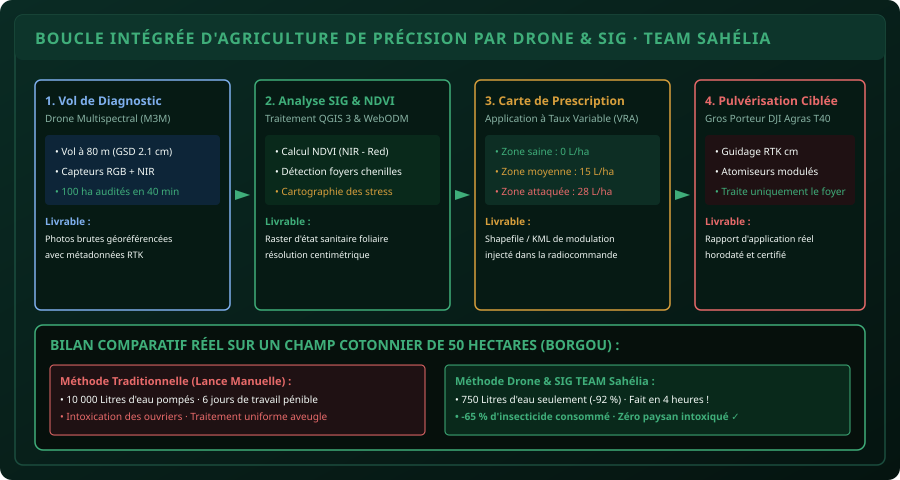

# CHAPITRE 6 : LE CYCLE COMPLET D'AGRICULTURE DE PRÉCISION
## De l'orthomosaïque multispectrale à la carte de prescription et au traitement robotisé par drone

> **Manuel :** 11 — Pilotage de Drones & Drones Agricoles : Cartographie, Télédétection & Pulvérisation de Précision  
> **Auteur :** Sègla Bio KPEROU, Olivier AREMOU & TEAM Sahélia  
> **Temps d’apprentissage :** 55 minutes de lecture + 60 minutes d'atelier Capstone intégré  
> **Illustration associée :** `schemas/schema_06_boucle_complete_agriculture_precision_drone.svg`

---

## 1. Objectifs d'Impact Réel
À la fin de ce chapitre, vous saurez :
1. **Connecter de bout en bout l'ensemble des compétences du Pôle 2** : de la cartographie QGIS (Manuel 06) et l'analyse statistique (Manuel 04) jusqu'au pilotage opérationnel des aéronefs.
2. **Exécuter la boucle fermée de l'agriculture de précision en 4 étapes** : Diagnostic multispectral $\rightarrow$ Analyse SIG $\rightarrow$ Carte de prescription vectorielle à taux variable (VRA) $\rightarrow$ Pulvérisation ciblée autonome.
3. **Réduire jusqu'à 65 % la quantité de produits phytosanitaires** appliqués sur une parcelle grâce à la modulation spatiale intra-parcellaire.
4. **Assurer la maintenance, le nettoyage et l'hivernage d'une flotte de drones agricoles**.
5. **Réaliser le grand Projet Capstone Final** et obtenir la double certification Agronomie Numérique & Télépilote Agricole TEAM Sahélia.

---

## 2. La Vision de l'Agriculture de Précision TEAM Sahélia

Dans l'agriculture conventionnelle, lorsqu'un champ de 50 hectares commence à être attaqué par les chenilles légionnaires, le paysan achète des dizaines de bidons d'insecticide et pulvérise l'intégralité des 50 hectares de manière uniforme et aveugle.  
**Conséquences :** 80 % du produit est gaspillé sur des plants parfaitement sains, la faune auxiliaire utile (abeilles, coccinelles) est décimée, le coût financier ruine le producteur et les nappes phréatiques sont polluées.

L'approche de **TEAM Sahélia** repose sur l'intelligence spatiale et robotique : **traiter uniquement là où le problème existe, à la dose exacte requise**.



---

## 3. Le Déroulé Pas-à-Pas de la Boucle Fermée

### Étape 1 : Le Vol de Diagnostic Multispectral
- Un drone léger de télédétection (ex: DJI Mavic 3 Multispectral) est programmé pour survoler les 50 hectares à $80\text{ mètres}$ de hauteur en vol autonome en peigne (GSD $\approx 2.1\text{ cm/pixel}$).
- La mission dure environ 35 minutes sur 2 batteries.
- Les capteurs enregistrent la réflectance dans le Vert, le Rouge, le RedEdge et le Proche Infrarouge (NIR).

### Étape 2 : Le Traitement Photogrammétrique & NDVI sous QGIS 3
- Les clichés bruts sont assemblés dans WebODM ou Pix4D pour produire l'orthomosaïque et le modèle d'élévation.
- Dans QGIS 3 (Manuel 06, Chapitre 5), vous calculez le raster NDVI :
  ```sql
  NDVI = ( "B08_NIR" - "B04_Red" ) / ( "B08_NIR" + "B04_Red" )
  ```
- Les parcelles saines ressortent en vert vif ($\text{NDVI} > 0.65$), tandis que le foyer d'attaque parasitaire apparaît nettement sous forme d'une tache jaune/rougeâtre au centre du champ ($\text{NDVI} < 0.35$).

### Étape 3 : Création de la Carte de Prescription Vectorielle (VRA)
Dans QGIS, vous découpez la parcelle en zones de gestion homogènes (*Zoning*) :
- **Zone 1 (Plants vigoureux, 35 hectares) :** Dose de traitement = **$0\text{ L/ha}$ (Aucune pulvérisation nécessaire !)**.
- **Zone 2 (Bordure de sécurité / début d'infestation, 10 hectares) :** Dose modérée préventive = **$12\text{ L/ha}$**.
- **Zone 3 (Foyer critique d'attaque larvaire, 5 hectares) :** Traitement curatif renforcé = **$25\text{ L/ha}$**.
- Exportez cette couche vectorielle au format Shapefile (`.shp`) ou KML compatible avec les contrôleurs de vol agricoles.

### Étape 4 : L'Exécution par le Drone Gros Porteur de Pulvérisation
- La carte de prescription est importée par clé USB ou synchronisation cloud dans la radiocommande du drone pulvérisateur (DJI Agras T40).
- Le drone décolle en mode mission automatique guidé par son antenne GNSS RTK centimétrique.
- En survolant la Zone 1, les pompes restent totalement coupées.
- Dès que le drone franchit la frontière de la Zone 3, les atomiseurs rotatifs s'enclenchent automatiquement à plein régime, appliquant la dose exacte au mètre carré près avant de se couper à la sortie du foyer !

---

## 4. Bilan Économique & Écologique Réel (Nord-Bénin)

Sur une exploitation cotonnière de 50 hectares dans le département du Borgou :

| Indicateur de Performance | Méthode Traditionnelle Manuelle | Méthode Drone & SIG TEAM Sahélia | Gain Réalisé |
| :--- | :--- | :--- | :--- |
| **Volume d'eau consommé** | $10\,000\text{ litres}$ (corvées harassantes) | **$750\text{ litres}$** (UBV modulé) | **$-92.5\,\%$ d'eau préservée** |
| **Quantité d'insecticide pur** | 50 litres (dose pleine aveugle) | **17.5 litres** (traitement zonal) | **$-65\,\%$ d'intrants chimiques** |
| **Temps d'exécution** | 5 à 7 jours à 4 ouvriers | **3 heures et demie** de vol | **Travail 15 fois plus rapide** |
| **Pertes par piétinement** | $\approx 2.5\text{ hectares}$ écrasés (valeur $1\,200\,000\text{ FCFA}$) | **$0\text{ hectare}$ (survol pur)** | **$+1.2\text{ million FCFA}$ sauvés** |
| **Intoxication humaine** | Risque sanitaire maximal | **Risque zéro** (pilotage à 50 m du champ) | **Santé des paysans préservée** |

---

## 5. Maintenance, Nettoyage & Carnet de Vol du Télépilote

Un drone agricole est soumis à des poussières abrasives, des produits chimiques corrosifs et de fortes vibrations.

### Protocole de Fin de Journée :
1. **Rinçage immédiat du circuit hydraulique :** Remplir la cuve avec 10 litres d'eau claire et pulvériser pendant 2 minutes pour purger les tuyaux, pompes et atomiseurs rotatifs avant que les résidus ne sèchent et ne collent.
2. **Nettoyage du châssis :** Essuyer les bras en carbone et les moteurs avec un chiffon humide propre. Ne jamais utiliser de nettoyeur haute pression (Kärcher) sur l'électronique étanche !
3. **Contrôle des serrages :** Vérifier le couple de serrage des vis des porte-hélices et des bagues de verrouillage des bras.
4. **Le Carnet de Vol (*Flight Log*) :**  
   Consigner pour chaque vol : Date, Heure, Nom du pilote, Numéro de série de la machine, Coordonnées du site, Temps de vol, Nombre de cycles de batterie et incidents éventuels. C'est l'exigence légale de traçabilité aéronautique.

---

## 6. Le Défi Capstone Final du Pôle 2 & Certification Sahélia

> ### 🏆 Défi Capstone : Le Dossier Professionnel de Télépilote Agronome
> 
> Vous êtes mandaté par une coopérative agricole de N'Dali pour auditer et traiter un verger d'anacardiers de 30 hectares :
> 
> 1. **Dossier de Sécurité Pré-Vol :**
>    - Établir la déclaration de mission selon les règles de l'ANAC Bénin.
>    - Remplir la checklist météo (vent, température, Kp) et la checklist machine en 12 points.
> 2. **Planification Photogrammétrique (Manuel 11, Ch. 4) :**
>    - Déterminer la hauteur de vol pour obtenir un GSD $\le 2.5\text{ cm/pixel}$.
>    - Calculer le temps de vol et le nombre de batteries nécessaires.
> 3. **Intégration SIG QGIS (Manuel 06, Ch. 4 & 5) :**
>    - Générer la carte d'indice NDVI du verger.
>    - Digitaliser les parcelles et créer la carte de prescription à 3 niveaux de dosage.
> 4. **Calibration Hydraulique (Manuel 11, Ch. 5) :**
>    - Calculer le débit minute des atomiseurs pour une vitesse de $5\text{ m/s}$ et une largeur de bande de $8\text{ mètres}$.
> 5. **Rapport de Synthèse & Soutenance :**
>    - Présenter la carte finale mise en page aux normes CAMES (Manuel 06, Ch. 6) avec cartouche officiel :  
>      *Réalisé par : Sègla Bio KPEROU & Olivier AREMOU · TEAM Sahélia*.
> 
> **Félicitations exceptionnelles :** La validation de ce dossier consacre votre statut d'**Agronome-Numéricien & Télépilote Certifié TEAM Sahélia** !

---

## 7. Fiche Mémo Récapitulative Détachable

```text
================================================================================
             FICHE MÉMO · CYCLE INTÉGRÉ D'AGRICULTURE DE PRÉCISION
================================================================================
1. LA CHAÎNE DIGITALE COMPLÈTE EN 4 TEMPS :
   [ Vol Drone Carto ] ➔ [ Orthomosaïque & NDVI dans QGIS ]
          ➔ [ Carte de Prescription VRA ] ➔ [ Pulvérisation Drone Agras ]

2. IMPACT CONSTATÉ SUR LE TERRAIN :
   - Économie moyenne d'intrants phytosanitaires : 50 % à 70 %.
   - Économie d'eau : Plus de 90 % grâce à l'Ultra-Bas Volume (UBV).
   - Zéro écrasement mécanique des cultures (gain net de 5 % de récolte).
   - Sécurisation absolue de la santé humaine des ouvriers agricoles.

3. ENTRETIEN SYSTÉMATIQUE DU GROS PORTEUR :
   - Purger et rincer le circuit à l'eau claire après chaque séance de travail.
   - Ne jamais laisser de bouillie chimique stagner dans la cuve pendant la nuit.
   - Stocker les aéronefs à l'abri des rongeurs et de la poussière sahélienne.
================================================================================
TEAM Sahélia · Apprendre. Créer. Innover.
================================================================================
```
