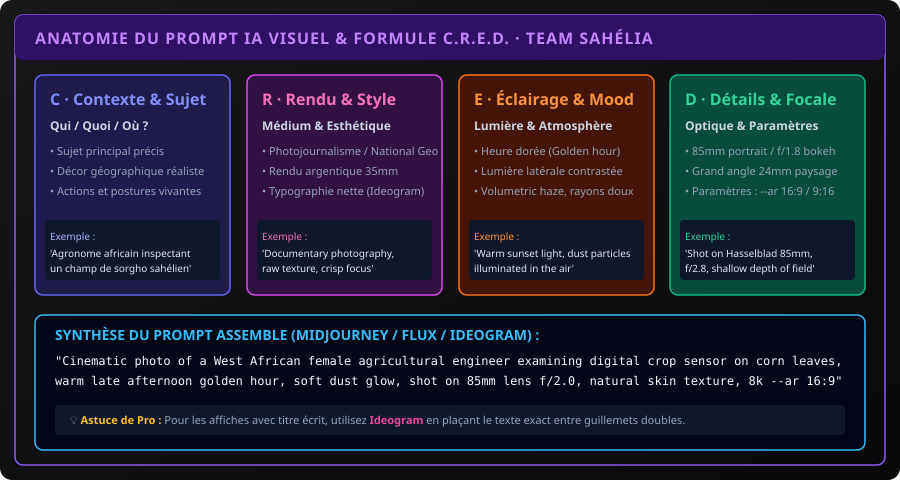

# CHAPITRE 1 : L'ART DU PROMPTING VISUEL & GÉNÉRATION D'IMAGES PAR IA
## Maîtriser la formule C.R.E.D., la typographie intégrée et concevoir des affiches professionnelles haute définition

> **Manuel :** 12 — Création Vidéo & Visuelle par Intelligence Artificielle : Des Prompts aux Logiciels Professionnels  
> **Auteur :** Olivier AREMOU, Ségla Bio KPEROU & TEAM Sahélia  
> **Temps d’apprentissage :** 45 minutes de lecture + 30 minutes d'expérimentation  
> **Illustration associée :** `schemas/schema_01_anatomie_prompt_ia_visuel.svg`

---

## 1. Objectifs d'Impact Réel
À la fin de ce chapitre, vous saurez :
1. **Rédiger un prompt visuel de niveau professionnel** sans vous perdre dans des listes de mots-clés désordonnés, grâce à la structure universelle **C.R.E.D.** (Contexte, Rendu, Éclairage, Détails de caméra).
2. **Choisir le modèle d'IA adapté à votre objectif** : Midjourney v6 pour le photoréalisme artistique, Ideogram v2 pour la typographie et affiches avec texte parfait, Flux.1 pour le rendu anatomique et la texture de peau, Canva IA pour l'édition rapide.
3. **Contrôler les ratios d'aspect et la composition** (`--ar 16:9` cinématographique, `--ar 9:16` vertical smartphone, `--ar 4:5` pour flux Instagram/LinkedIn).
4. **Appliquer les réglages d'objectifs et de focales** (24mm grand angle pour les paysages agricoles, 85mm f/1.8 pour les portraits de chercheurs avec bokeh doux).
5. **Nettoyer et agrandir vos images en 4K** sans perte de qualité avec des outils gratuits et open source (Upscayl).

---

## 2. Le Mythe du Prompt Miracle vs La Méthode C.R.E.D.

Beaucoup de débutants tapent des requêtes vagues comme :  
*« Image d'un agronome dans un champ avec un drone, hyper réaliste, 8k, très beau »*  
Le résultat est souvent décevant : des mains déformées, un éclairage artificiel en plastique et un rendu générique sans âme.

Les créateurs d'élite utilisent une architecture rigoureuse appelée **C.R.E.D.** :



### La Structure C.R.E.D. Décomposée :
1. **C · Contexte & Sujet (Qui, Quoi, Où) :**  
   Définissez clairement l'action et le contexte culturel ou géographique :  
   *« A Beninese female agricultural researcher in a beige lab coat and protective boots, kneeling to inspect soil moisture sensors in a green cassava field in Parakou. »*
2. **R · Rendu & Médium Stylistique :**  
   Spécifiez la matière et le style visuel exact :  
   *« Documentary photojournalism style, National Geographic aesthetic, film grain, unedited authentic look. »*
3. **E · Éclairage & Atmosphère (Lighting & Mood) :**  
   L'éclairage est l'élément qui donne 80 % de l'émotion à une image :  
   *« Late afternoon golden hour, warm directional sunlight hitting from the side, soft ambient dust particles glowing in the air. »*
4. **D · Détails Caméra & Optique :**  
   Indiquez l'appareil, l'objectif et l'ouverture pour contraindre le modèle à un comportement optique réel :  
   *« Shot on Sony Alpha 7R V, 85mm G-Master prime lens, f/2.2 aperture, sharp subject focus with shallow depth of field and blurred foliage background. »*

---

## 3. Comparatif des Modèles Phares en 2026

| Outil IA | Forces Majeures | Limites / Précautions | Cas d'Usage Recommandé |
| :--- | :--- | :--- | :--- |
| **Ideogram v2** | Typographie parfaite, respecte les textes écrits entre guillemets. | Moins personnalisable au niveau des micro-textures. | **Affiches de formation, bannières, infographies.** |
| **Midjourney v6** | Esthétique cinématographique supérieure, textures organiques. | Payant (Discord), gestion du texte parfois aléatoire. | **Visuels de couverture, scènes héroïques, paysages.** |
| **Flux.1 (Black Forest)** | Mains parfaites, anatomie humaine impeccable, open-weights. | Nécessite un bon GPU en local ou crédits en ligne. | **Portraits professionnels, scènes scientifiques réelles.** |
| **Canva Magic Studio** | Intégré à la mise en page, gomme magique et recadrage facile. | Qualité de prompt pur inférieure aux modèles spécialisés. | **Publications rapides réseaux sociaux et présentations.** |

---

## 4. Générer des Affiches Scientifiques & Bannières avec Texte Intégré (Ideogram)

Pour concevoir une affiche officielle sans devoir repasser 3 heures sur Photoshop :
```text
Poster design for a West African Tech Forum. Bold modern typography in the upper third reading "TEAM SAHÉLIA - AGRI-TECH 2026". In the center, a 3D isometric glowing digital map of an African farmland with drone survey lines in vibrant emerald green and cyber orange. Clean dark slate background, high contrast, minimalist layout, vector-infused cinematic style. --ar 4:5
```

> **Règle d'or Ideogram :** Placez toujours le texte exact entre **guillemets doubles (" ")**. Si vous écrivez `"TEAM SAHÉLIA"`, l'IA placera exactement ces lettres sans faute d'orthographe.

---

## 5. Upscaling HD & Optimisation Finale

Une image générée par IA sort généralement en résolution native d'environ $1024 \times 1024$ ou $1344 \times 768$ pixels. Pour une impression A3 ou un affichage 4K :
1. **Téléchargez Upscayl (Gratuit & Open Source) :** Disponible sous Windows, Mac et Linux.
2. **Modèle de traitement :** Choisissez `Digital Art` pour les affiches vectorielles ou `UltraSharp` pour les photos d'agronomie.
3. **Mise à l'échelle :** Multipliez par 4x pour obtenir un fichier de $4096 \times 4096$ pixels parfaitement net, prêt pour l'impression ou l'intégration vidéo.

---

## 6. Exercice Pratique : Le Promptbook Visuel

> ### 🛠️ Atelier d'Application :
> Rédigez et testez un prompt C.R.E.D. pour promouvoir la session de formation sur le pilotage de drones :
> 1. Définissez l'agronome avec sa radiocommande sur le terrain.
> 2. Intégrez l'heure dorée et la poussière atmosphérique.
> 3. Spécifiez l'objectif 35mm f/2.8 pour capturer à la fois le pilote et la perspective du champ.
> 4. Exportez et agrandissez l'image obtenue en 4K.
