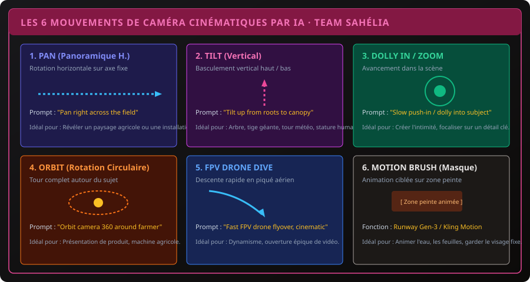

# CHAPITRE 2 : LES MODÈLES DE GÉNÉRATION VIDÉO PAR IA & CONTRÔLE DE CAMÉRA
## Text-to-Video, Image-to-Video, mouvements de caméra cinématiques et masques de mouvement

> **Manuel :** 12 — Création Vidéo & Visuelle par Intelligence Artificielle : Des Prompts aux Logiciels Professionnels  
> **Auteur :** Olivier AREMOU, Ségla Bio KPEROU & TEAM Sahélia  
> **Temps d’apprentissage :** 50 minutes de lecture + 40 minutes de génération vidéo  
> **Illustration associée :** `schemas/schema_02_mouvements_camera_ia_video.svg`

---

## 1. Objectifs d'Impact Réel
À la fin de ce chapitre, vous saurez :
1. **Comprendre la différence fondamentale** entre la génération Text-to-Video (T2V) et Image-to-Video (I2V), et pourquoi les professionnels n'utilisent presque jamais le T2V seul.
2. **Garantir la cohérence des personnages et des décors** d'un plan à un autre sans déformation ni métamorphose involontaire.
3. **Piloter les mouvements de caméra par prompt et réglages de paramètres** (Pan, Tilt, Dolly Zoom, Orbit 360, FPV Drone Dive).
4. **Utiliser le Motion Brush (pinceau de mouvement)** pour n'animer que l'eau, les feuilles ou les nuages en figeant le sujet principal.
5. **Maîtriser les meilleurs outils du marché** : Runway Gen-3 Alpha, Kling AI, Luma Dream Machine, Pika et Haiper.

---

## 2. Text-to-Video vs Image-to-Video (Le Secret de la Cohérence)

- **L'Erreur du Text-to-Video (T2V) :**  
  Demander à l'IA `"Vidéo d'un agronome marchant dans un champ"` génère un personnage différent à chaque essai. Le visage change, la couleur du t-shirt change, l'arrière-plan saute. C'est inutilisable pour une vidéo scénarisée.
- **La Méthode Pro : Image-to-Video (I2V) :**  
  1. Vous générez d'abord une image de départ parfaite et ultra-nette (avec Midjourney ou Flux).
  2. Vous injectez cette image fixe comme **First Frame** (image de référence) dans le moteur vidéo.
  3. Vous décrivez uniquement le **mouvement de la caméra et l'action physique** à appliquer à cette image.  
  *Résultat :* Le personnage, le décor et les habits restent 100 % cohérents !

---

## 3. Les 6 Mouvements de Caméra Cinématiques par IA

### Guide des Commandes Pratiques :
1. **PAN (Panoramique Horizontal) :**
   - *Prompt :* `"Static character, smooth camera pan from left to right revealing the solar panels in the background, slow motion 24fps"`
   - *Usage :* Révéler l'étendue d'une exploitation agricole ou d'une infrastructure.
2. **TILT (Basculement Vertical) :**
   - *Prompt :* `"Camera tilts slowly upwards from the dry soil cracks to the green canopy of the drought-resistant maize crop"`
   - *Usage :* Montrer la hauteur d'une culture, un arbre fruitier ou la fierté d'un chercheur.
3. **DOLLY IN / PUSH-IN (Avancement Lent) :**
   - *Prompt :* `"Slow cinematic push-in towards the engineer's eyes inspecting the screen of the drone controller"`
   - *Usage :* Focaliser l'attention, dramatiser un moment clé, créer de la connexion émotionnelle.
4. **ORBIT 360 (Rotation Circulaire Autour du Sujet) :**
   - *Prompt :* `"Camera orbits smoothly 180 degrees around the tractor standing in the center of the field at sunset"`
   - *Usage :* Mise en valeur d'un équipement technologique ou d'un prototype.
5. **FPV DRONE DIVE (Survol Dynamique en Piqué) :**
   - *Prompt :* `"Dynamic low-altitude FPV drone flyover skimming closely over cashew tree leaves, fast fluid movement"`
   - *Usage :* Plan d'ouverture dynamique pour captiver le spectateur dans les 3 premières secondes.
6. **MOTION BRUSH (Pinceau de Masquage Dynamique) :**
   - Dans Runway Gen-3 ou Kling AI, peignez en violet les feuilles du champ et réglez l'intensité à +3 (vent doux). Laissez le chercheur non peint : il reste net et ne bouge que légèrement les yeux, sans aucune déformation corporelle.

---

## 4. Panorama Comparatif des Outils Vidéo IA

| Moteur IA | Version Actuelle | Points Forts | Meilleur Rendu |
| :--- | :--- | :--- | :--- |
| **Runway Gen-3 Alpha** | Gen-3 Alpha Turbo | Contrôle de caméra ultra-précis, gestion du réalisme physique. | Mouvements cinématographiques lents et plans larges. |
| **Kling AI (v1.5)** | Kling Pro / Free | Mouvements humains naturels, très peu de déformations de membres. | Personnages en mouvement, marche, gestes des mains. |
| **Luma Dream Machine** | Dream Machine 1.6 | Vitesse de rendu impressionnante, transitions de caméra extrêmes. | Effets d'accélération et scènes d'action rythmées. |
| **Pika 2.0** | Pika Effects | Effets créatifs (gonflement, fusion, fonte), interface ludique. | Visuels publicitaires conceptuels et animations décalées. |

---

## 5. La Règle des Rushes Courts (3 à 5 Secondes)

Ne cherchez jamais à générer un plan de 20 secondes d'un coup. Les modèles IA actuels accumulent des erreurs géométriques après 5 secondes.
- **La Méthode Éprouvée :** Générez des segments de **4 à 5 secondes**.
- Dans votre montage final, vous ne garderez que les **2 à 3 meilleures secondes** de chaque plan.
- C'est ce découpage rapide qui donne aux vidéos YouTube Shorts, Reels et TikTok leur dynamisme professionnel.

---

## 6. Exercice Pratique : Le Plan Séquence Agricole

> ### 🛠️ Atelier d'Application :
> 1. Prenez l'image d'un champ générée au Chapitre 1.
> 2. Chargez-la dans Kling AI ou Runway Gen-3 en mode Image-to-Video.
> 3. Rédigez le prompt de caméra : `"Smooth slow dolly forward, gentle wind rustling the leaves, cinematic golden hour lighting, 4k"`.
> 4. Exportez le clip MP4 et vérifiez la fluidité du mouvement.
