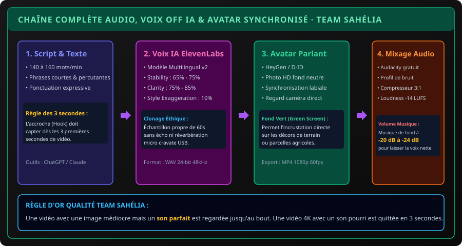

# CHAPITRE 3 : VOIX OFF DE SYNTHÈSE, CLONAGE VOCAL ÉTHIQUE & AVATARS PARLANTS
## Narration documentaire avec ElevenLabs, nettoyage audio sous Audacity et synchronisation labiale HeyGen

> **Manuel :** 12 — Création Vidéo & Visuelle par Intelligence Artificielle : Des Prompts aux Logiciels Professionnels  
> **Auteur :** Olivier AREMOU, Ségla Bio KPEROU & TEAM Sahélia  
> **Temps d’apprentissage :** 45 minutes de lecture + 35 minutes de traitement sonore  
> **Illustration associée :** `schemas/schema_03_chaine_voix_et_avatar_ia.svg`

---

## 1. Objectifs d'Impact Réel
À la fin de ce chapitre, vous saurez :
1. **Rédiger un script de voix off captivant** calibré au mot près pour respecter le rythme naturel de la parole humaine (140 à 160 mots par minute).
2. **Générer des voix off ultra-expressives avec ElevenLabs** en paramétrant la stabilité, la clarté et l'exagération de style pour éviter le son robotique.
3. **Cloner une voix réelle de manière éthique** et professionnelle à partir d'un échantillon propre de 60 secondes.
4. **Nettoyer un enregistrement audio sur Audacity (gratuit)** : supprimer le souffle de ventilateur, compresser la dynamique et normaliser le niveau sonore.
5. **Créer un avatar parlant photo-réaliste avec HeyGen ou D-ID** synchronisé sur votre voix avec fond vert (*green screen*) pour incrustation.

---

## 2. L'Importance Capitale de l'Audio dans la Vidéo

Dans le milieu de la production audiovisuelle, un adage universel s'impose :  
> *« Les spectateurs pardonnent une image imparfaite, mais ils quittent une vidéo en 3 secondes si le son est désagréable, métallique ou inaudible. »*

La chaîne de production audiovisuelle moderne articulée par TEAM Sahélia assure un son impeccable :



---

## 3. Paramétrer ElevenLabs pour une Narration Naturelle

Pour obtenir une voix documentaire captivante qui ne ressemble pas à un assistant GPS :
1. **Choix du Modèle :** Utilisez impérativement **Eleven Multilingual v2**.
2. **Paramètres Vocaux Recommandés :**
   - **Stability (Stabilité) :** Réglez entre **60 % et 75 %**. En dessous de 50 %, la voix devient chaotique ; au-dessus de 85 %, elle devient monotone.
   - **Clarity / Similarity Enhancement :** Réglez entre **75 % et 85 %**. Assure une diction nette tout en gommant les artefacts.
   - **Style Exaggeration :** Maintenez entre **5 % et 15 %**. Donne de la couleur et de l'intonation sans surjouer.
3. **Ponctuation Intelligente dans le Script :**
   - Utilisez des points de suspension (`...`) pour marquer des respirations naturelles de 0,5 seconde.
   - Mettez les mots clés en MAJUSCULES légères ou entourez-les de tirets pour induire une accentuation tonique naturelle.

---

## 4. Nettoyage Audio Professionnel sous Audacity (100 % Gratuit)

Même si vous enregistrez votre propre voix avec un micro smartphone, vous pouvez obtenir un rendu de studio radio en 3 étapes dans Audacity :

```text
[ Fichier Brut ] ──> [ Effet > Réduction de Bruit ] 
                 ──> [ Effet > Compresseur ] 
                 ──> [ Effet > Normaliser l'intensité sonore (-14 LUFS) ]
```

1. **Élimination du Bruit de Fond :**
   - Sélectionnez 2 secondes de silence pur au début de l'enregistrement.
   - Allez dans **Effet > Réduction de bruit > Obtenir le profil du bruit**.
   - Sélectionnez tout le fichier (`Ctrl + A`), puis retournez dans **Effet > Réduction de bruit** (Réduction : 10-12 dB, Sensibilité : 6) et validez.
2. **Compression Vocale :**
   - Appliquez le compresseur avec un ratio de **3:1** et un seuil de **-18 dB**. Cela rehausse les passages trop bas et calme les pics saturés.
3. **Normalisation LUFS (Loudness) :**
   - Normalisez à **-14 LUFS** (standard YouTube et podcasts). Votre voix sera audible au même volume que les plus grandes chaînes professionnelles.

---

## 5. Avatars Parlants Photo-Réalistes avec HeyGen

Pour présenter un cours ou un rapport sans devoir installer des projecteurs et une caméra 4K :
1. **Source Visuelle :** Prenez une photo nette de face, bonne lumière, regard droit dans l'objectif (générée par IA ou photo réelle).
2. **Chargement dans HeyGen :** Importez l'image dans l'onglet **Photo Avatar**.
3. **Audio :** Importez le fichier WAV propre généré sur ElevenLabs.
4. **Arrière-Plan :** Sélectionnez **Green Screen (Fond Vert)**. Cela vous permettra de supprimer le fond dans CapCut et d'incruster votre avatar devant un champ de maïs, une serre ou une carte QGIS interactive !

---

## 6. Exercice Pratique : Création de la Bande Son Officielle

> ### 🛠️ Atelier d'Application :
> 1. Écrivez un script de 30 secondes (environ 65 mots) présentant les atouts du sorgho résistant à la sécheresse.
> 2. Générez la voix off avec ElevenLabs (voix française ou anglaise à timbre chaleureux).
> 3. Ouvrez le fichier dans Audacity, nettoyez le bruit résiduel et exportez en `WAV 48 kHz 24-bit`.
