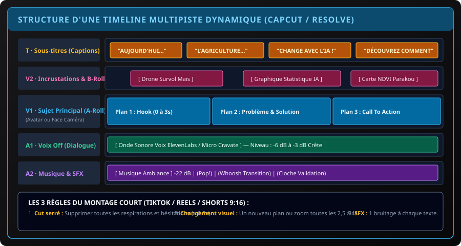

# CHAPITRE 4 : MONTAGE VIDÉO DYNAMIQUE SUR MOBILE & PC AVEC CAPCUT
## Découpage rythmé, sous-titres automatiques animés, incrustations B-Roll et sound design

> **Manuel :** 12 — Création Vidéo & Visuelle par Intelligence Artificielle : Des Prompts aux Logiciels Professionnels  
> **Auteur :** Olivier AREMOU, Ségla Bio KPEROU & TEAM Sahélia  
> **Temps d’apprentissage :** 50 minutes de lecture + 45 minutes de montage pratique  
> **Illustration associée :** `schemas/schema_04_timeline_montage_dynamique_capcut.svg`

---

## 1. Objectifs d'Impact Réel
À la fin de ce chapitre, vous saurez :
1. **Maîtriser CapCut sur PC et Mobile** (versions gratuites sans filigrane commercial).
2. **Structurer une timeline multipiste propre** (A-Roll principal, B-Rolls d'illustration, piste de sous-titres et pistes audio séparées).
3. **Appliquer la technique du « Jump Cut »** pour éliminer les temps morts et maintenir un rythme hypnotique.
4. **Générer des sous-titres automatiques stylisés en un clic** avec mise en avant dynamique des mots clés en couleur.
5. **Enrichir vos créations par le Sound Design** : transitions sonores (*whoosh*), impacts (*hits*) et bruitages d'interface (*pops*).

---

## 2. Anatomie d'une Timeline Multipiste Moderne

Le montage professionnel ne consiste pas à jeter des vidéos les unes après les autres. C'est un empilement vertical synchronisé :

### Les 5 Pistes Stratégiques :
- **Piste T (Texte & Sous-titres) :** Captions animées mot par mot pour captiver 80 % des internautes qui regardent les vidéos sur smartphone sans le son.
- **Piste V2 (B-Rolls & Visuels) :** Inserts d'illustrations (cartes SIG, plans de drone, graphiques) qui viennent masquer les coupures de parole de l'orateur.
- **Piste V1 (A-Roll) :** La colonne vertébrale visuelle (votre avatar ou vous-même face caméra).
- **Piste A1 (Voix Off) :** Le son principal de la narration, toujours placé à -3 dB crête.
- **Piste A2 (Musique & Sound FX) :** La musique d'ambiance à volume maîtrisé (-22 dB) ponctuée de bruitages percutants.

---

## 3. Les Sous-Titres Automatiques Dynamiques (Auto-Captions)

Plus de 75 % des vidéos sur TikTok, Instagram et LinkedIn sont visionnées sans le son dans les transports ou au bureau. Les sous-titres ne sont pas une option, ce sont les accroches principales :
1. Dans CapCut PC ou Mobile, cliquez sur **Texte > Sous-titres automatiques (Auto Captions)**.
2. Choisissez la langue (Français) et cliquez sur **Générer**.
3. **Animation de Style :** Choisissez le modèle d'animation par mot (*Karaoké dynamic* ou *Pop*).
4. **Typographie d'Impact :**
   - Police recommandée : **The Bold Font**, **Montserrat Black** ou **Futura**.
   - Couleur du corps : Blanc éclatant avec contour noir de 2 pixels.
   - Couleur d'accentuation des mots-clés : **Jaune solaire (#FBBF24)** ou **Vert émeraude (#10B981)**.

---

## 4. Le Rythme Vidéo : La Règle des 3 Secondes

Pour maximiser le temps de rétention sur les algorithmes modernes :
- **Toutes les 2,5 à 4 secondes**, le spectateur doit recevoir un nouveau stimulus visuel ou sonore :
  - Soit un changement de plan (cut vers un plan de drone ou une infographie).
  - Soit un zoom dynamique de 10 % sur le sujet (*punch zoom*).
  - Soit l'apparition d'un mot-clé ou d'un schéma vectoriel accompagné d'un effet sonore (*Whoosh* ou *Pop*).

---

## 5. Exporter Proprement Sans Filigrane

1. **Suppression du filigrane CapCut :** À la fin de la timeline sur mobile, supprimez simplement le clip noir final portant le logo CapCut. Sur PC, il n'y a aucun filigrane d'office.
2. **Paramètres d'Exportation Idéaux :**
   - **Résolution :** 1080p ($1080 \times 1920$ pour vertical, $1920 \times 1080$ pour horizontal).
   - **Cadence d'images (Frame rate) :** 30 fps ou 60 fps (pour une fluidité maximale).
   - **Débit binaire (Bitrate) :** Plus élevé / VBR 2 passes (environ 15 à 20 Mbps).
   - **Format :** MP4 (Codec H.264).

---

## 6. Exercice Pratique : Montage Express d'un Réel de 30 Secondes

> ### 🛠️ Atelier d'Application :
> 1. Importez votre voix off générée au Chapitre 3 et vos 3 plans vidéo du Chapitre 2.
> 2. Découpez les silences pour obtenir un débit fluide.
> 3. Générez les sous-titres automatiques et colorez les 3 mots les plus importants en jaune.
> 4. Ajoutez une musique libre de droits (YouTube Audio Library) calée à -22 dB.
> 5. Exportez et visionnez sur votre smartphone.
