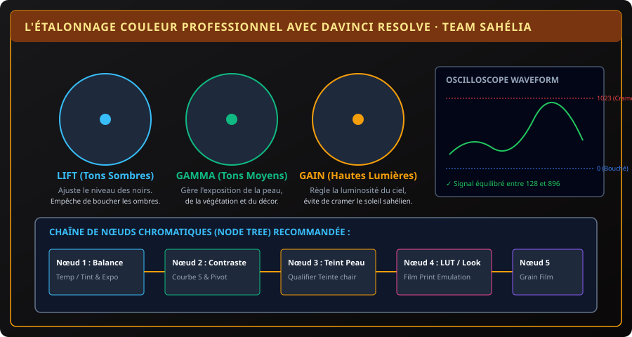

# CHAPITRE 5 : POST-PRODUCTION PROFESSIONNELLE AVEC DAVINCI RESOLVE
## Étalonnage couleur, lecture des oscilloscopes, mixage audio Fairlight et export Master 4K

> **Manuel :** 12 — Création Vidéo & Visuelle par Intelligence Artificielle : Des Prompts aux Logiciels Professionnels  
> **Auteur :** Olivier AREMOU, Ségla Bio KPEROU & TEAM Sahélia  
> **Temps d’apprentissage :** 55 minutes de lecture + 45 minutes d'étalonnage  
> **Illustration associée :** `schemas/schema_05_etalonnage_couleur_davinci_resolve.svg`

---

## 1. Objectifs d'Impact Réel
À la fin de ce chapitre, vous saurez :
1. **Prendre en main l'interface de DaVinci Resolve** (version gratuite de Blackmagic Design, la plus puissante au monde).
2. **Lire et interpréter les oscilloscopes professionnels** (Waveform, Parade RVB et Vectorscope) pour ne plus jamais vous fier à un écran mal calibré.
3. **Réaliser un étalonnage couleur en 5 nœuds séquentiels** (Balance d'exposition, contraste de courbe, teinte de peau naturelle et Look cinématographique).
4. **Mixer vos dialogues et vos musiques dans la page Fairlight** avec égalisation paramétrique, compresseur multibande et ducking automatique.
5. **Configurer la page Delivery** pour un export 4K sans perte de piqué pour YouTube et les archives institutionnelles.

---

## 2. Pourquoi DaVinci Resolve est le Choix des Studios

Alors que la plupart des logiciels imposent des abonnements mensuels coûteux, **DaVinci Resolve offre gratuitement 95 % de ses fonctionnalités hollywoodiennes**. C'est le standard absolu de l'étalonnage couleur dans le cinéma mondial.



---

## 3. Les Trois Roues Primaires : Lift, Gamma & Gain

Dans la page **Color** de DaVinci Resolve, les trois roues chromatiques agissent sur des plages d'intensité précises :
- **LIFT (Les Noirs & Ombres) :** Ajuste le plancher lumineux. Abaissez-le pour donner de la densité aux ombres sans écraser les détails.
- **GAMMA (Les Tons Moyens) :** Contrôle la luminosité générale du visage, de la peau et de la verdure des cultures.
- **GAIN (Les Hautes Lumières & Blancs) :** Règle le plafond lumineux. Rehaussez-le pour donner de l'éclat au soleil sans saturer (*crêter*) le ciel.

---

## 4. L'Oscilloscope Waveform : La Vérité Mathématique du Signal

Votre écran d'ordinateur portable peut être trop lumineux ou trop sombre selon la pièce où vous travaillez. L'oscilloscope Waveform affiche la valeur électrique exacte des pixels, graduée de **0** (noir absolu) à **1023** (blanc pur saturé) :
- **La Règle d'Exposition Sahélienne :**  
  - Les ombres doivent osciller entre **64 et 128**.  
  - La peau humaine doit se situer entre **512 et 650**.  
  - Le ciel ou les reflets ne doivent jamais dépasser **950** pour préserver la nuance des nuages.

---

## 5. L'Arbre de Nœuds (Node Tree) Professionnel

Ne faites jamais toutes vos modifications sur un seul nœud. Créez une chaîne ordonnée :
```text
[ Nœud 1 : Exposition & Balance ] ──> [ Nœud 2 : Contraste Courbe en S ]
                                 ──> [ Nœud 3 : Teinte Peau / Masque ]
                                 ──> [ Nœud 4 : LUT Créative / Emulation Film ]
```

1. **Nœud 1 (Balance des Blancs) :** Utilisez la pipette de balance des blancs sur un élément blanc neutre du décor (le tee-shirt du chercheur ou une feuille de papier).
2. **Nœud 2 (Contraste) :** Créez une légère courbe en « S » pour détacher le sujet du fond.
3. **Nœud 3 (Teinte Peau) :** Sur le Vectorscope, vérifiez que la couleur de peau s'aligne rigoureusement sur la *« Skin Tone Line »*, quel que soit le phototype.
4. **Nœud 4 (LUT Créative) :** Appliquez une LUT d'émulation de pellicule argentique (ex: Kodak 2383) en réduisant l'opacité à 40 % pour un cachet documentaire élégant.

---

## 6. Mixage Fairlight & Normalisation Audio

Dans l'onglet **Fairlight** :
1. **L'Égaliseur Paramétrique (EQ) :** Activez le filtre coupe-bas (*High-Pass*) à **80 Hz** sur la voix humaine pour supprimer les bruits sourds de vent, de pas ou de vibrations de table.
2. **Ducking Automatique (Sidechain) :** Configurez la piste de musique pour qu'elle baisse automatiquement de **-6 dB** dès que l'orateur prend la parole, et qu'elle remonte doucement lors des respirations.

---

## 7. Exercice Pratique : Étalonner un Rush Réel

> ### 🛠️ Atelier d'Application :
> 1. Ouvrez DaVinci Resolve et importez un rush vidéo tourné en extérieur ou généré par IA.
> 2. Ouvrez la page Color et activez l'oscilloscope Waveform.
> 3. Ajustez le Lift et le Gain pour occuper harmonieusement la plage 100-900.
> 4. Exportez le plan étalonné en ProRes ou H.264 Master 1080p.
