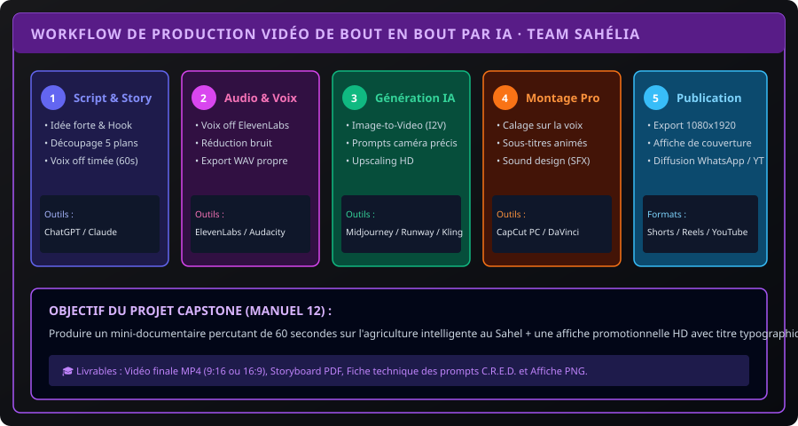

# CHAPITRE 6 : PROJET CAPSTONE · MINI-DOCUMENTAIRE SCIENTIFIQUE & AFFICHE OFFICIELLE
## Réalisation de bout en bout d'un teaser vidéo de 60 secondes et d'une affiche promotionnelle haute définition

> **Manuel :** 12 — Création Vidéo & Visuelle par Intelligence Artificielle : Des Prompts aux Logiciels Professionnels  
> **Auteur :** Olivier AREMOU, Ségla Bio KPEROU & TEAM Sahélia  
> **Temps d’apprentissage :** 1h de préparation + 2h de production  
> **Illustration associée :** `schemas/schema_06_workflow_production_video_complete_ia.svg`

---

## 1. Le Défi Capstone : Le Dossier de Production Numérique

Pour valider l'acquisition des compétences du **Manuel 12** et prétendre à la certification officielle de niveau **Platine (Vibe Coding & IA / Création de Contenu)** décernée par TEAM Sahélia, chaque apprenant doit concevoir et livrer un dossier complet de production audiovisuelle.



---

## 2. Le Cahier des Charges du Projet

### Thématique au Choix :
- **Sujet A (Agronomie de Précision) :** *« Comment les drones et l'IA sauvent les cultures sahéliennes de la sécheresse. »*
- **Sujet B (Vibe Coding & IA) :** *« Construire des applications web utiles pour sa communauté sans coder pendant 6 mois. »*
- **Sujet C (Formation & Émancipation) :** *« La révolution des compétences numériques à l'Université de Parakou et au Bénin. »*

---

## 3. Les 5 Livrables Obligatoires du Dossier

```text
DOSSIER_CAPSTONE_PRENOM_NOM/
├── 01_SCRIPT_ET_STORYBOARD.pdf      (Script minuté, voix off, découpage 5 plans)
├── 02_PROMPTBOOK_CRED.txt           (Les 5 prompts C.R.E.D. et paramètres utilisés)
├── 03_AFFICHE_OFFICIELLE_4K.png     (Affiche avec titre typographique net 4:5 ou A3)
├── 04_BANDE_AUDIO_NETTOYEE.wav      (Voix off ElevenLabs ou micro normalisée -14 LUFS)
└── 05_VIDEO_FINALE_MASTER.mp4       (Teaser de 60 secondes monté, sous-titré et étalonné)
```

### Critères d'Évaluation de la Commission TEAM Sahélia :
1. **L'Accroche des 3 Secondes (Hook) :** Le premier plan doit susciter une vive curiosité (visuel spectaculaire + question percutante).
2. **Qualité Sonore Irréprochable :** Voix intelligible, équilibrée, sans saturation, musique calée en retrait sans couvrir les dialogues.
3. **Cohérence Visuelle :** Les décors et personnages générés par IA ne doivent pas muter d'un plan à l'autre (application stricte de la méthode Image-to-Video).
4. **Sous-titres & Typographie :** Sous-titres dynamiques synchronisés, sans faute d'orthographe, avec mise en avant des mots pivots.
5. **Étalonnage :** Image chaleureuse, dynamique, respectant les normes d'exposition (ombres débouchées, ciel non cramé).

---

## 4. Grille de Notation & Délibération

| Critère d'Évaluation | Pondération | Seuil Minimal Requis |
| :--- | :--- | :--- |
| **Storytelling & Qualité du Script** | 20 points | 14 / 20 |
| **Finesse des Prompts C.R.E.D. & Choix I2V** | 20 points | 15 / 20 |
| **Qualité Audio & Voix Off (Audacity/ElevenLabs)** | 20 points | 16 / 20 |
| **Dynamisme du Montage & Sous-titrage (CapCut/Resolve)** | 25 points | 18 / 25 |
| **Affiche HD & Rendu Visuel Final** | 15 points | 12 / 15 |
| **TOTAL GÉNÉRAL** | **100 points** | **75 points (Seuil d'Admissibilité)** |

---

## 5. Fiche Mémo Récapitulative Détachable

```text
================================================================================
             FICHE MÉMO · PRODUCTION VIDÉO & VISUELLE PAR IA
================================================================================
1. LE PROMPT C.R.E.D. EN 4 ÉTAPES :
   [ Contexte & Sujet ] + [ Rendu & Style ] + [ Éclairage ] + [ Détails Caméra ]

2. LA RÈGLE DE COHÉRENCE ABSOLUE :
   Toujours générer l'IMAGE FIXE d'abord (Midjourney / Flux), 
   puis l'animer en Image-to-Video (Kling / Runway Gen-3) avec des plans de 4s max.

3. LE MIXAGE SONORE STANDARD :
   - Voix Off Principale : -3 dB Crête / -14 LUFS (Normalisation)
   - Musique d'Ambiance  : -20 dB à -24 dB (Sous la voix)
   - Bruitages (SFX)     : -6 dB à -10 dB (Aux moments clés)

4. L'EXPORTATION SMARTPHONE :
   - Résolution : 1080 x 1920 (Vertical 9:16) ou 1920 x 1080 (Horizontal 16:9)
   - Framerate  : 30 fps ou 60 fps | Codec : H.264 | Bitrate : 15 Mbps
================================================================================
TEAM Sahélia · Apprendre aujourd'hui. Construire demain.
================================================================================
```

---

## 6. Consécration & Obtention de l'Open Badge Platine

Dès que votre projet Capstone est finalisé et validé par l'équipe pédagogique :
- Vous recevez votre **Badge Numérique Certifié Open Badges 3.0 (W3C Verifiable Credential)** track *« Vibe Coding & IA / Création de Contenu »*.
- Vous pouvez l'ajouter en **1 clic à votre profil LinkedIn** dans la section *Licences et Certifications*.
- Votre production est mise en avant sur les canaux officiels de la communauté **TEAM Sahélia** !
